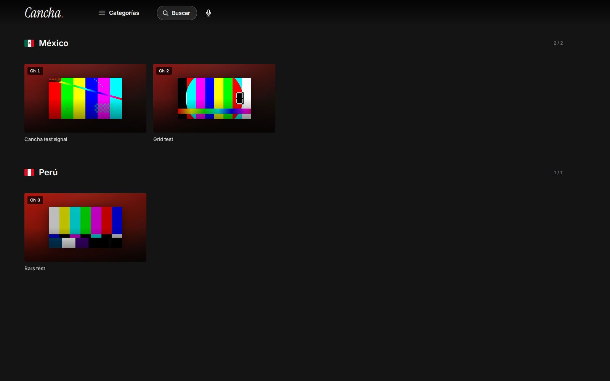

# Cancha

Cancha is a TV streaming and DVR app with a personal channel guide and player. Supply your HLS sources and channel metadata; it probes mirrors, selects a healthy feed and keeps a rolling buffer for playback and rewind. The web player and native Android TV app use the same backend.



## First result

Use Python 3.12 and install FFmpeg/FFprobe through your operating system.

```sh
git clone https://github.com/latintzar/cancha-tv.git
cd cancha-tv
python3 -m venv .venv
. .venv/bin/activate
python3 -m pip install -r server/requirements.txt
python3 tools/first-signal.py --serve
```

Open the loopback URL printed by the command. Choose a test signal to play it through Cancha’s actual HLS and DVR pipeline. The command also verifies mirror health, buffered segment delivery and rejection of an unissued proxy target. Generated media, catalogue and state live in a private temporary directory.

The example supplies three authored 20-second signals. Your own authorized catalogue is [configured separately](docs/setup.md).

## Build with it

- [Guide](docs/guide.md): first playback, channels and Android TV.
- [Setup](docs/setup.md): private catalogue, optional proxy and signing.
- [Architecture](docs/architecture.md): actual requests, buffering and playback.
- [Decisions](docs/decisions.md): original engineering choices and release corrections.
- [Source reference](docs/reference/README.md): functions, Kotlin entrypoints and JSON symbols.
- [Release status](RELEASE-STATUS.md): local proof and remaining acceptance.
- [Provenance](docs/provenance.md) and [third-party notices](THIRD-PARTY-NOTICES.md).

MIT, copyright Peter Neyra. [made by atelier neyra](https://atelierneyra.com)
