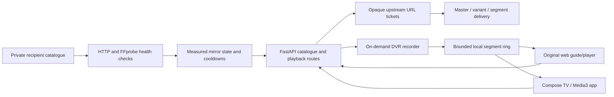

# Architecture

| Module | Responsibility |
|---|---|
| `server/catalog.py`, `models.py` | YAML configuration, channels, mirrors and health selection |
| `server/prober.py` | Real media probes, quality/stability scoring, thumbnails and periodic refresh |
| `server/proxy.py` | HLS URI rewriting and optional recipient proxy transport |
| `server/tickets.py` | Bounded in-memory opaque URL tickets, expiry and concurrency protection |
| `server/dvr.py` | Per-channel recording, ring pruning, codec checks and optional CPU conversion |
| `server/main.py` | Original HTTP API, app lifecycle, source-local assets and player delivery |
| `server/web.py` | Served original web UI; `web/index.html` is its static companion |
| `server/youtube.py` | Separate RSS/playlist/IFrame path |
| `android/app/src/main/kotlin/` | Native TV guide, Media3 player, client API and updater |
| `tools/first-signal.py` | Authored local input generation, real pipeline proof and native browser capture |
| `tools/runtime-env.py` | Recipient-private process configuration |

The web player and Android client request the same source selection and DVR routes. Recording starts on demand, stores segments in the selected state directory, prunes by duration and stops after inactivity. Codec handling can retain compatible segments or use bounded CPU FFmpeg conversion; the local fixture exercises the H264/AAC path.

Playlist rewriting previously exposed a visitor-editable base64 target. The release retains the route shape but replaces the target with a random server-issued reference. URLs stay in bounded server memory, expire after20 minutes and are reused for a repeated upstream URI. Capacity is16384 entries, with a hard constructor ceiling. A single worker is the supported store boundary; multiworker/shared-state operation is a separate design task.

The default catalogue is empty. A recipient selects its sources, accounts and state before enabling external access. [Workflows and tradeoffs](decisions.md) connect these modules to the original design. [Function references](reference/README.md) supply one-based source navigation and machine-readable symbols.
